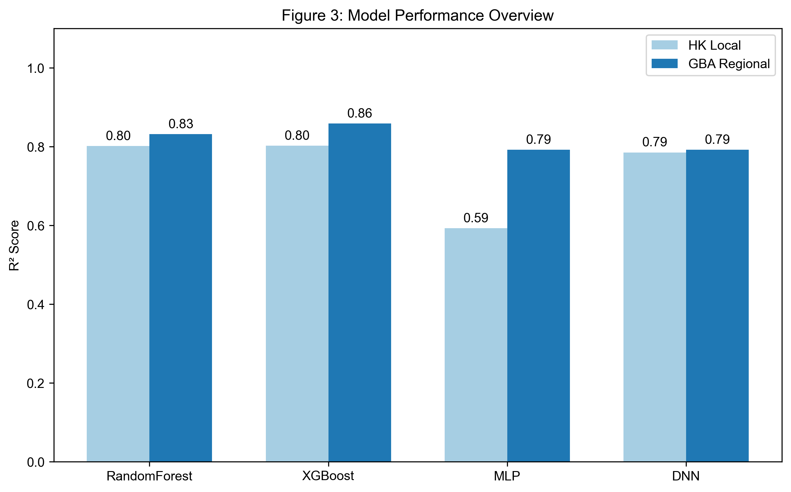
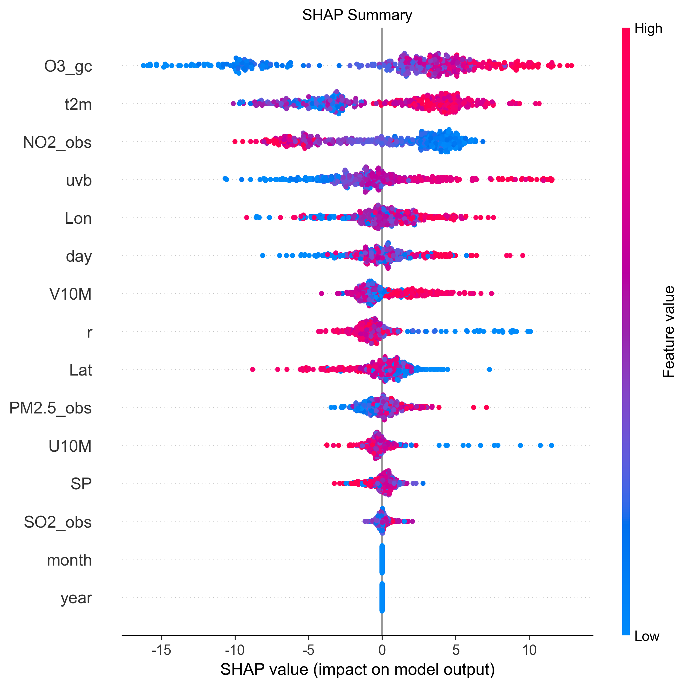

# Ozone Downscaling in the Greater Bay Area

[中文说明](README.zh-CN.md) · [Project report (PDF)](report.pdf) · [Authors and contributions](AUTHORS.md)

A research pipeline for station-level ozone bias correction using GEOS-Chem, ERA5 meteorology and ground-monitoring observations. It combines data preprocessing, spatiotemporal matching, XGBoost training, multi-model comparison, Model Confidence Set (MCS) analysis and SHAP interpretation.

The accompanying report is **A Physics-Consistent Machine Learning Framework for High-Resolution Ozone Downscaling in the Greater Bay Area**, by **Wentao Wang, Lifeng Han and Chenxi Pan (equal contribution)**. Lifeng Han implemented the code and prepared the figures.

<p align="center">
  
</p>

*An original figure from the supplied research outputs. The report gives a GBA XGBoost test R2 of approximately 0.86 under its random station-day split. These are recorded project results, not a fresh reproduction during repository preparation.*

## Pipeline and files

| Stage | Implementation | Output |
| --- | --- | --- |
| Daily fields | `src/preprocessing.py` | Processed GEOS-Chem and ERA5 NetCDF files in `cache/` |
| Station matching | `src/data_matcher.py` | Matched station-day table, `cache/final_dataset_full.csv` |
| Feature engineering | `src/features.py` | Pollutant, meteorological, baseline ozone and calendar predictors |
| Bias-correction model | `main.py`, `src/model.py`, `src/analysis.py` | XGBoost estimator, correlation/RMSE and diagnostic plots |
| Benchmark and interpretation | `generate.py` | RF/XGBoost/MLP/DNN comparisons, MCS tables and SHAP figures |

## Setup

Use Python 3.11 or 3.12 in a separate environment. On Windows, use a project and data path without non-ASCII characters if your netCDF4 build cannot open Unicode paths. The original project did not include a dependency lock file; `requirements.txt` lists the required packages, including `arch` for MCS analysis.

```bash
python -m venv .venv
# Windows PowerShell:
.venv\Scripts\Activate.ps1
# macOS/Linux:
# source .venv/bin/activate
python -m pip install -r requirements.txt
```

Obtain the prepared research inputs described in [data/README.md](data/README.md). The multi-gigabyte original dataset, trained models and caches are not bundled. Put compatible inputs in `data/`, or point to an existing directory:

```powershell
# Windows PowerShell
$env:OZONE_DATA_DIR = 'F:\AI_math\data'
python scripts/check_data.py
```

```bash
# macOS/Linux alternative
export OZONE_DATA_DIR=/path/to/prepared-data
python scripts/check_data.py
```

The data check reports missing required inputs without starting model training. It checks presence, not scientific compatibility; read the input schemas and unit assumptions before running.

## Run

```bash
# Preprocess, match observations, fit XGBoost, and inspect diagnostics
python main.py

# After main.py has created cache/final_dataset_full.csv:
# compare four models in HK/GBA, compute MCS, and produce SHAP figures
python generate.py
```

`main.py` saves the fitted estimator to `models/bias_correction_model_full.pkl`. Its Matplotlib diagnostics open interactively; set `MPLBACKEND=Agg` in a headless environment. `generate.py` writes figures to `Paper_Ultimate_Final_Tuned/` under the repository root. Full model searches and SHAP calculations can take substantial time; `generate.py` uses parallel CPU training. Close interactive plots to allow the first script to finish.

<details>
<summary>Original SHAP summary figure</summary>



</details>

## Scope and reproducibility

This release preserves the original modeling procedure. It adds the missing `arch` dependency, an input-presence check, an optional `OZONE_DATA_DIR` path and a working-directory-independent figure output path. It does not change the reported experiments or retune their models.

The workflow uses prepared gridded inputs; the original downloads and initial high-resolution regridding are not included. `generate.py` uses random 80/20 station-day train/test splits and three-fold model selection. `main.py` also shuffles rows before training, so its `TimeSeriesSplit` operates on that shuffled order and is **not a chronological forecasting validation**. The target outlier filter is applied before splitting, and no held-out-station evaluation is implemented. Treat the reported metrics as results of this particular experimental setup. The raw-input ozone unit conversion and optional-input limitations are documented in [data/README.md](data/README.md).

The public report preserves all authors and research content while removing student identification numbers. Raw input redistribution rights were not established, so no raw data or derived station tables are published. This repository provides research code and documentation; users need compatible, lawfully obtained inputs for a complete reproduction.

## License

The Python code and repository documentation are provided under the [MIT License](LICENSE). The accompanying research report and original research figures retain their authors' rights and are not relicensed by the code license. Third-party datasets and dependencies remain subject to their own terms.

